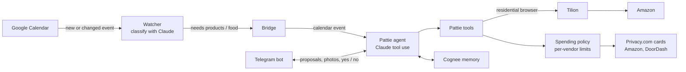

# Pattie

**A personal shopping agent that reads your calendar and shops for what's coming.**

Pattie is named in honor of [Pattie Maes](https://www.media.mit.edu/people/pattie/overview/), pioneer of software agents. It watches your Google Calendar, notices events that need things (a flight, a birthday, a full-day hackathon), proposes what you might need in Telegram, finds it on Amazon, and buys it after you say yes, on a card with hard limits. When your day is packed, it asks ahead whether to order breakfast or dinner.

Built at the Personal Agents Hackathon, San Francisco, November 20, 2026. After the demo, OpenBot was replaced by Pattie's own Telegram bot and agent loop, which is simpler to run and test.

## How it works



1. **Calendar event:** the watcher reads the calendar with Google's API and asks Claude what the event needs: products, a food nudge, or nothing.
2. **Proposal:** Pattie messages you in Telegram, for example "Hackathon tomorrow, 13 hours. Want a power bank and some snacks?"
3. **Search and rank:** on a yes, Pattie searches Amazon through Tilion and offers **one best pick** when the choice is obvious, or **three options** (cheapest, best rated, one more) when it isn't. Sponsored results are always labeled and never ranked higher for being sponsored.
4. **Buy:** after your yes, the spending policy checks the vendor's limits and Pattie sends a one-tap Amazon cart link; you place the order in your own account. Pattie never signs in to Amazon: when it tried to check out in a signed-in browser, Amazon flagged it as an unauthorized AI agent, so agent checkout waits for Amazon's permission.

## Principles

From [TENETS.md](TENETS.md): the owner keeps control of their data; the provider handles updates; mobile first; proactive, triggered by the calendar or a chat message; open-weight models where they're good enough; every action traceable (Amplitude, Statsig, SingleStore); and it remembers you (Cognee).

## What works today

| Part | Status |
|---|---|
| Google Calendar watcher (service account, sync tokens) | Working on the server, reading the demo calendar |
| Event classification and food nudges (Claude) | Working |
| Amazon search through Tilion, "sold by Amazon.com" only | Working; Amazon blocks non-residential traffic, so it uses Tilion's residential sessions |
| Ranking: one pick or three, budgets, must-haves, sponsored labels | Working, with tests |
| Pattie agent (Claude Sonnet 5.5, tool use) and Telegram bot | Built and tested with fakes; live once the bot token is in 1Password |
| Spending policy and ledger, per vendor | Working, with tests |
| Privacy.com card client (status, freeze, unfreeze) | Built and tested; cards not connected yet |
| Bridge from the watcher to the agent (queue, retries, food-nudge timing) | Built and tested |
| Calendar events reaching Pattie (watcher, bridge, agent, Telegram) | Built and tested offline |
| Agent checkout | Paused: Amazon flagged signed-in agent checkout. Checkout sends a policy-checked cart link |

## Stack

| Layer | Choice |
|---|---|
| Chat | Telegram, Pattie's own bot (Bot API, long polling, owner pairing) |
| Agent | Claude Sonnet 5.5 with tool use (Messages API), one container on a Hostinger VPS |
| Triggers and source of truth | Google Calendar and the Telegram chat |
| Browser | [Tilion](https://tilion.dev), residential egress |
| Memory | Cognee |
| Data layer | Airbyte (planned) |
| Tracing | Amplitude, Statsig, SingleStore audit trail |
| Secrets | 1Password service accounts (`op run`), no keys on disk |
| Payments | Privacy.com, one merchant-locked card per vendor |
| Network | Tailscale: no open inbound ports on the server |
| Models | Open-weight where good enough; Claude Sonnet as fallback |

## Repository

| Path | What's there |
|---|---|
| [docs/PRD.md](docs/PRD.md) | Product requirements, flows and the demo script |
| [docs/ARCHITECTURE.md](docs/ARCHITECTURE.md) | Technical architecture, with open questions as a FAQ |
| [Context.md](Context.md) | Legal context for agents on Amazon, and Pattie's shopping rules |
| [docs/Amazon_Ad_Revenue.md](docs/Amazon_Ad_Revenue.md) | Amazon's ad revenue vs. retail revenue and profit, 2015–2025 |
| [pattie/](pattie/) | The Python package: watcher, classifier, ranking, memory, tools, policy, cards, bridge |
| [config/policy.json](config/policy.json) | Spending limits per vendor |
| [infra/](infra/) | Server setup script and the `pattie` container (bot, agent, calendar watcher) |
| [demo/](demo/) | Demo calendar, demo persona, and the setup guide |
| [tests/](tests/) | Tests for ranking, tools and policy, the bridge and the audit trail |

## Run it locally

Needs Python 3.10 or newer. Full setup, including the demo calendar and Google service account, is in [demo/README.md](demo/README.md).

```bash
python3 -m pip install --user uv
python3 -m uv venv --python 3.12 .venv
python3 -m uv pip install --python .venv/bin/python -r requirements.txt
.venv/bin/python -m pytest tests/                     # all tests, no network
.venv/bin/python -m pattie.watcher --ics demo/pattie-demo-calendar.ics --once --no-memory
```

Live Amazon search needs a Tilion API key in `TILION_API_KEY` (see `.env.example`); classification needs `ANTHROPIC_API_KEY`.

## Team

- **Emmalou Schmucker**: product, PRD, calendar watcher, classifier, ranking, memory, analytics
- **Mauricio**: architecture, server and security, tools, spending policy, cards, agent and Telegram bot
