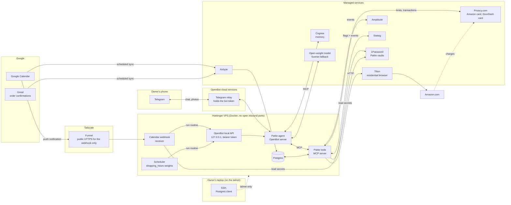
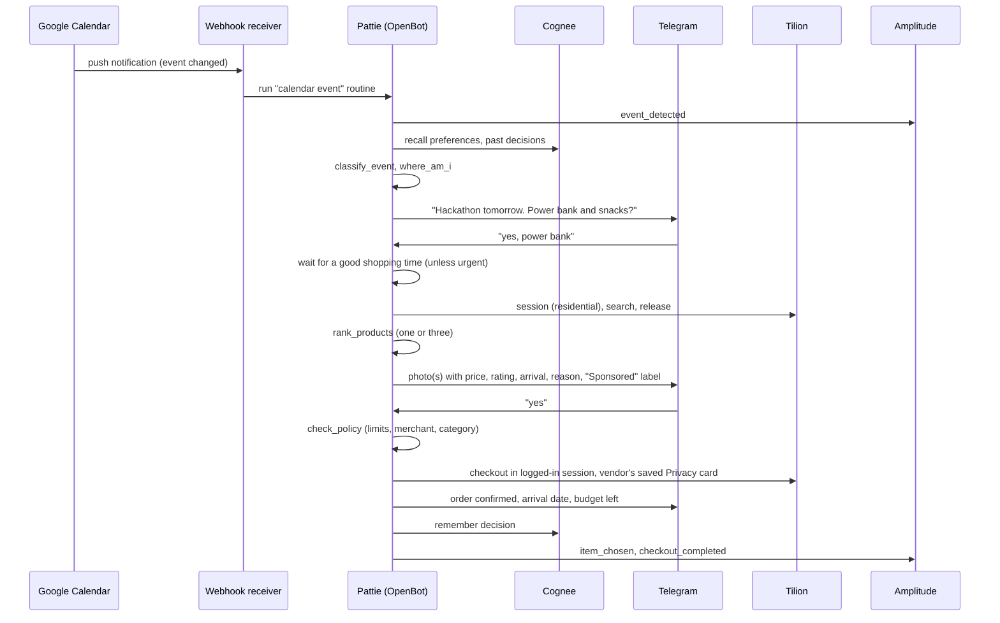

# Pattie — Technical Architecture

Nov 20, 2026 · Personal Agents Hackathon SF

This document describes how Pattie is built. It draws on the other documents in this repo:

- [PRD](PRD.md): what Pattie does, the flows, and the demo
- [TENETS.md](../TENETS.md): the seven principles every component must respect
- [Context.md](../Context.md): the legal situation and the rules for shopping on Amazon
- [shopping_hours.py](../shopping_hours.py), [tilion.py](../tilion.py), [amazon_search.py](../amazon_search.py): code that already works

Open questions, including the points where the PRD and Context.md disagree, are collected in the [FAQ](#faq-open-questions) at the end.

## Stack at a glance

| Layer | Choice | Role |
|---|---|---|
| User interface | **Telegram** | The only interface. Proposals, photos, replies, cart links and food nudges all happen in one Telegram chat |
| Sources of truth and triggers | **Google Calendar** and **Telegram chat** | Both are authoritative and both start the agent: a new or changed calendar event, or something the owner says in chat |
| Agent runtime | **[OpenBot](https://openbot.run/)** server on a **Hostinger VPS** | Runs the Pattie agent, its routines and its built-in Telegram connector |
| Tools | **Pattie tools MCP server** on the VPS | Wraps the code in this repo: Amazon search, cart links, shopping hours, tracing |
| Browser | **Tilion** (cloud), residential egress | Reads Amazon search and product pages |
| Memory and state | **Cognee** + Postgres | Cognee for long-term memory; Postgres for exact records such as the basket and prices |
| Data layer | **Airbyte** | Moves calendar and order-confirmation data into Postgres |
| Tracing and experiments | **Amplitude** + **Statsig** | Every agent step is logged; flags control risky or tunable behavior |
| Network security | **Tailscale** | The VPS has no open inbound ports. Admin access goes over a private Tailscale network, and the one public endpoint (the calendar webhook) goes through Tailscale Funnel |
| Secrets | **1Password** | Holds every access key, the Amazon session and the virtual card details, in vaults made for Pattie. Services read them at run time through 1Password service accounts; nothing sensitive sits in plain files or in the model's context |
| Payments | **Privacy.com** virtual cards, one per vendor (Amazon, DoorDash) | Merchant-locked cards with monthly limits at Privacy, plus Pattie's per-vendor spending policy |
| Model | Open-weight model preferred; **Claude Sonnet** as fallback | Classifies events, ranks products, writes messages |

## System diagram



## Sources of truth and triggers

Pattie has two sources of truth, and either one can start the agent:

| Source | Authoritative for | Starts the agent when |
|---|---|---|
| **Google Calendar** | Scheduled plans: what's happening, when, where, and with whom | An event is added or changed |
| **Telegram chat** | Anything the owner tells Pattie: plans that aren't on the calendar ("hosting dinner Saturday"), where they are ("in Austin until Friday"), preferences ("no more neck pillows"), corrections ("the flight moved to Thursday") and direct requests ("order dinner", "find a gift for Lisa") | The owner sends a message |

**When they disagree,** the owner's most recent explicit statement in chat wins over the calendar for that fact, because it's the newest and most direct information. "I'm not going to the meetup" cancels that event's food nudge even though the event is still on the calendar. A chat fact that changes plans has an expiry ("until Friday") or is tied to one event, so the calendar takes over again afterward.

**Pattie never writes to the calendar.** Facts from chat are saved instead:

- **Chat-only plans** go into Postgres as `plan` records with the same fields as a calendar event (type, start, end, location, `source: chat`). Every flow treats them like calendar events, so "hosting dinner Saturday" can lead to a proposal for party supplies.
- **Preferences and corrections** go to Cognee (`remember`).
- **Location statements** go to the location context with their expiry (see [Location awareness](#location-awareness)).

Each chat-derived fact keeps the message it came from, so the owner can ask "why do you think that?" and Pattie can quote it.

**Chat is handled right away.** An owner message never waits for a good shopping hour, because the owner is actively asking. Only follow-up browsing that isn't urgent, such as a long-term basket item, is scheduled through `shopping_hours.py`.

## Components

### Telegram (user interface)

Pattie uses **OpenBot's built-in Telegram connector** ([messaging docs](https://github.com/nightly-labs/openbot/blob/main/docs/messaging.md)). Nothing needs to be built for the chat itself.

**Setup.** In OpenBot, open **Server settings → Connectors → Telegram** and choose **Open a direct chat**. Telegram opens with a one-time link that's valid for 15 minutes; press **Start**, and the chat appears in OpenBot. OpenBot then asks for the model of the **Telegram Orchestrator**, the agent that answers every Telegram chat on this server. Pattie is that orchestrator: its instructions are Pattie's.

**How messages travel.** The bot is OpenBot's own bot, not one the owner creates. Telegram sends messages to OpenBot's relay service, which passes them to the VPS. The relay holds the bot token, and the VPS never has it. In a direct chat, every owner message reaches Pattie. In a group, Pattie only answers when mentioned or replied to, so Pattie uses a **direct chat**.

**What the connector supports, per OpenBot's docs:**

- Text messages both ways.
- **Files up to 20 MB both ways**, which covers product photos (around 10 KB each in the kitchen-cart demo).
- **Approve** and **Deny** buttons on approvals, and a **Stop** button on running tasks.
- No history API: the agent only sees messages the server received since it started, plus the message being answered. Anything Pattie must remember goes to Cognee or Postgres, not to the chat.

**Message design.**

- **Proposals:** one message listing up to five item types with a reason for each. The owner replies "all", "none", or names the items.
- **Options:** each option is a photo with a caption (price, rating, arrival date, why it fits, "Sponsored" if it is). One option for an obvious choice, three when it isn't (PRD flow 4). The owner replies "yes", or "A", "B" or "C".
- **Cart link:** one message with the Amazon cart handoff link and the total.
- **Allowlist:** Pattie's instructions and the tools check the sender's Telegram user ID. Messages from anyone other than the owner get no action.

**Proactive messages.** Calendar events, food nudges and basket triggers start Pattie through a routine, not through a chat message. OpenBot's messaging docs confirm a routine can post on its own: "Any agent can post to a connected place on its own initiative", using the `openbot.messaging_post` tool (find the chat with `openbot.messaging_list_places`). The routine's instructions must call that tool, because "the scheduler does not post the run's answer." Telegram "posts only in its own chat", which is the owner's direct chat.

**Why Telegram.** OpenBot supports it out of the box, Pattie needs no phone number (the bot is OpenBot's), and the connection is official, so nothing can get blocked on demo day. WhatsApp was tried on Nov 20 and parked: see below.

### WhatsApp (later option)

Checked on Nov 20 and parked for the hackathon, because Pattie would need its own phone number and the free internet numbers we tried (TextNow-style) were rejected. Kept here for after the hackathon, and for the pitch ("next: WhatsApp, where most people already are").

- **OpenBot has a built-in WhatsApp connector** ([messaging docs](https://github.com/nightly-labs/openbot/blob/main/docs/messaging.md)): **Marketplace → Apps → WhatsApp → Link WhatsApp → A number only for OpenBot**, then scan the QR code under WhatsApp → **Linked devices → Link a device**, pick the **WhatsApp Orchestrator** model, and allow the owner under **Who can write**. Messages go directly between the VPS and WhatsApp, with no relay.
- **Risk:** "OpenBot uses an unofficial client, and WhatsApp can restrict or block a number that it sees as automated." Use a dedicated number only: a prepaid SIM or eSIM (about $5 to $15) is reliable; free VoIP numbers are mostly rejected and more likely to be flagged.
- **Differences from Telegram:** files up to 64 MB; approvals have no buttons ("Reply 1 to approve or 2 to deny"); WhatsApp drops a linked device after about 14 days offline.
- **Official alternatives:** Meta's WhatsApp Cloud API (free test number, up to 5 recipients, but templates outside a 24-hour window) or Twilio (paid per message). Neither has an OpenBot connector, so each needs a custom bridge.
- **Also looked at:** [Linq](https://linqapp.com/hackathon) (iMessage, RCS and SMS for agents; free 7-day hackathon sandbox; no WhatsApp; also needs a custom bridge).

### Google Calendar

The calendar is the record of scheduled plans. Pattie reads it and never writes to it (read-only OAuth scope, per the PRD's privacy mitigation). There are two paths, because each one covers what the other can't:

| Path | How | Used for |
|---|---|---|
| **Trigger** | Google Calendar push notifications (`events.watch`) post to a webhook receiver on the VPS. The receiver checks Google's channel token, fetches what changed (sync token), and starts Pattie's "calendar event" routine through OpenBot's local API, once per new or changed event | Reacting within seconds |
| **Context** | Airbyte syncs the full calendar into Postgres on a schedule | History, patterns ("travels to NY monthly"), recovery if a push is missed |

- **Why a receiver in between:** Google's push notifications carry no HMAC signature, so they can't go straight to an OpenBot webhook routine, which requires one.
- **Why Airbyte isn't the trigger:** Airbyte's Google Calendar connector only supports full syncs, with no incremental or streaming mode.
- **Keeping it alive:** watch channels expire, so the receiver renews them daily. If the webhook is down, a fallback poll runs a few times a day at irregular times.

The calendar also provides the **time-zone setting** and **event locations**, both inputs to location awareness.

### OpenBot on a Hostinger VPS (agent runtime)

[OpenBot](https://openbot.run/) ([nightly-labs/openbot](https://github.com/nightly-labs/openbot)) runs a team of AI agents on a computer or server. Each agent has its own role, instructions, workspace and conversation, and runs on a provider harness of your choice. Pattie is one OpenBot agent.

**Hosting.**

- Install the OpenBot server on a Hostinger KVM VPS with the Ubuntu and Docker template, using either OpenBot's install script or its Docker Compose file (`compose.yaml` plus `seccomp.json`). Then sign the host in with `openbot login`.
- Hostinger's one-click image is built for OpenClaw, so it isn't used.
- This satisfies tenet 1 (the owner controls the server) and most of tenet 2 (Hostinger handles the base image and backups). For the rest, turn on unattended security upgrades and pin OpenBot to a release you update deliberately.

**Sizing.** 2 vCPU and 8 GB of RAM is enough for OpenBot, the tools MCP server, the webhook receiver, the scheduler and Postgres. The browser runs in Tilion's cloud and the model runs remotely, so the VPS does no heavy work.

**Mobile access (tenet 3).** Everyday use is Telegram on the phone. The owner can also open OpenBot's iOS or Android app to see Pattie's conversations, runs and approvals, through OpenBot's remote-access service. The OpenBot container publishes no web port.

**License.** OpenBot uses the PolyForm Noncommercial 1.0.0 license: free for personal and noncommercial use, including this hackathon.

**Routines.** Pattie has one routine for each trigger that doesn't come from chat:

| Routine | Started by | Payload |
|---|---|---|
| Calendar event | Webhook receiver | The new or changed event |
| Scheduled check | Scheduler | Which check: basket prices, fallback calendar poll |
| Food nudge | Scheduler, at the time the PRD sets | The meal, the event, the delivery place |

Each is started through OpenBot's **local automation API**:

- The API listens on `127.0.0.1` only, on a port OpenBot picks, and needs a bearer token. OpenBot writes the URL and token to local files that the receiver and scheduler read.
- A call is `POST /v1/agents/:agentId/routines/:routineId/run` with `{"payload": "..."}`. The payload is the event or job as JSON text, appended to the routine's instructions.
- OpenBot also offers webhook routines (a public, HMAC-signed URL per routine, routed through OpenBot's account service). Pattie doesn't need them, because all its non-chat triggers start on the VPS.

**Scheduling.** A small scheduler on the VPS starts the scheduled checks, rather than a fixed cron. After each run, it draws the next start time from `shopping_hours.pick_start_time()` and sleeps until then, so nothing runs on a fixed schedule (Context.md, Rules 2 and 3). Food nudges are the exception: they fire at the times the PRD sets (8 PM the evening before, one hour before an event ends), because they depend on the owner's schedule.

**Tools.** Pattie's tools live in one **Pattie tools MCP server** (Python, on the VPS), attached to the agent as a user-added MCP server next to Cognee's. It wraps the code already in this repo:

| Tool | Does | Backed by |
|---|---|---|
| `classify_event` | Decides whether an event needs products or food, and which type it is | Model + Cognee (past decisions) |
| `suggest_items` | Lists up to five item types with reasons | Model + Cognee (preferences) |
| `search_products` | Searches Amazon; returns ASIN, title, price, rating, reviews, photo, sponsored flag | Tilion (`amazon_search.py`) |
| `rank_products` | Scores fit, rating, price and delivery date; applies the one-or-three rule and the sponsored policy | Model + rules + Statsig flags |
| `check_policy` | Checks a proposed purchase against that vendor's limits and the overall monthly limit; returns allow, ask, wait or block | `config/policy.json` + ledger |
| `checkout` | Buys the approved items at Amazon or DoorDash with that vendor's Privacy card. The card details go from 1Password straight into the browser and never pass through the model | 1Password + Tilion (logged-in session) |
| `card_status` | Per vendor card: spend so far, what's left, recent purchases, card state at Privacy | Ledger + Privacy API |
| `freeze_card` / `unfreeze_card` | Pauses or reopens one vendor's card | Privacy API |
| `build_cart_link` | Builds the Amazon cart handoff URL, used when checkout isn't possible | Pure function |
| `add_to_basket` / `check_basket` | Manages the long-term basket and price watch; fires the $35, price-drop and safe-order-date triggers | Postgres + Cognee + Tilion |
| `suggest_food` | Finds meal gaps and drafts an order with a deep link | Calendar + Cognee + location |
| `where_am_i` | Returns current city, time zone and delivery addresses | Location context |
| `remember` / `recall` / `forget` | Reads and writes long-term memory | Cognee MCP server |

Pattie doesn't use OpenBot's built-in browser for Amazon, because Amazon needs residential egress.

**Network.**

- No inbound ports are open to the internet. Admin access is over Tailscale, and the calendar webhook is published through Tailscale Funnel. See [VPS security (Tailscale)](#vps-security-tailscale).
- OpenBot's local API, the MCP servers and Postgres listen only on `127.0.0.1`, the Docker network or the Tailscale interface.
- OpenBot agents can run commands and use the network. Give Pattie only the MCP servers it needs, and turn off shell access where the harness allows it.

### Tilion (browser)

The tools server reaches Amazon through Tilion's cloud browser over HTTP, using `tilion.py`.

- **Residential egress is required for Amazon.** In testing, a one-shot `/v1/scrape` of an Amazon search came back `challenged` (access denied). A session created with `residential: true` returned full results on every request.
- **One session per shopping sitting.** Open a session, visit the homepage, run the searches, release it (`with t.session(residential=True)`). Cookies carry across pages, the visit looks like one person browsing (Context.md, Rule 4), and billing stays short.
- **One session at a time.** `search_products` holds a lock, so a second request waits instead of opening a parallel session.
- **Seller filter.** Searches add `rh=p_6:ATVPDKIKX0DER` to show only items sold by Amazon.com, as in the kitchen-cart demo.
- **Logged-in session for checkout.** Searching doesn't need an account; checkout does. The `checkout` tool opens a **persistent** Tilion session that carries the owner's Amazon cookies, loaded from 1Password, and saves the refreshed cookies back to 1Password afterward. If Amazon asks for a one-time code, Pattie asks the owner in Telegram and waits.
- **Photos.** Search results include each product's image URL. The tools server downloads the image so Pattie can send it as a photo in Telegram.
- **Open product pages by ASIN** (`/dp/<ASIN>`), never through sponsored result links. A sponsored link redirects through Amazon's ad-click tracking and bills the advertiser, so following them automatically would count as automated ad clicks, which the PRD rules out. The sponsored flag is read from the search page; no ad is clicked.
- **Failures.** A body `status` other than `ok` (`challenged`, `hard_blocked`, `rate_limited`) is an answer, not a transport error. Log it, don't retry right away, and tell the owner in Telegram if a search they're waiting on can't finish.
- **Fallback.** If the Product Advertising API or Creators API keys arrive (PRD), use them for product data and keep Tilion for what the API doesn't cover. The PRD's curated catalog remains the demo fallback.

### Cognee and Postgres (memory and state)

Cognee holds everything Pattie should remember about the owner across conversations (tenet 7), through its v1 memory API (`remember`, `recall`, `forget`) and MCP server. This matters more with Telegram, because the connector has no message history.

| Memory | Examples | Written when |
|---|---|---|
| Profile | Has Prime, budgets per category, favorite brands, dietary restrictions, quiet hours | Onboarding, or whenever the owner states a preference |
| Delivery addresses | Home, office, frequent venues, and which kinds of deliveries go where | Onboarding, learned from order confirmations, confirmed in chat |
| Decisions | Accepted and declined proposals with reasons ("declined neck pillow: already owns one") | After every reply |
| Patterns | "Orders Thai after late events", "travels to NY monthly" | Derived by Cognee from the above and from Airbyte data |

**Postgres** keeps exact records that must be correct: chat-only `plan` records, the basket with prices, price history, which events were processed, open proposals waiting for a reply, and the sponsored-purchase count. Each basket item is stored in both places: exact fields in Postgres, a natural-language note in Cognee.

**Ownership (tenet 1).** Run Cognee self-hosted on the VPS, or use Cognee Cloud with export available. The owner can ask in Telegram "what do you know about me?" (`recall`) and "forget X" (`forget`).

### Location awareness

The agent must always know **where the owner is** (city, time zone) and **where deliveries go**. Sources, in priority order:

| Priority | Source | Gives |
|---|---|---|
| 1 | Owner says so in Telegram, or shares a location ("I'm in Austin until Friday") | Current city and time zone, with an end date |
| 2 | Calendar event in progress, or a trip event (flight, hotel, "Weekend Tahoe") | Current city during the trip |
| 3 | Google Calendar time-zone setting | Default time zone |
| 4 | Home address in the Cognee profile | Default city |

The `where_am_i` tool resolves these into one answer that every time-sensitive decision uses:

```json
{
  "city": "San Francisco",
  "timezone": "America/Los_Angeles",
  "source": "calendar_setting",
  "delivery": {
    "packages": "home",
    "food": "event venue if an event is in progress, otherwise home"
  },
  "valid_until": "2026-11-21T09:00:00-08:00"
}
```

- **Packages** go to the address the owner usually uses, learned from past orders. If they'll be away when the item arrives, Pattie asks.
- **Food** goes to where the owner will be at delivery time: the venue for breakfast at a hackathon, home after a late meetup (PRD flow 6).
- **Time zone** feeds `shopping_hours.py`, so the shopping weight always follows the owner's current local time, including when they travel.

### Airbyte (data layer)

Airbyte moves data from the owner's accounts into Postgres on the VPS. It runs syncs on a schedule, not as a stream. That's fine for Pattie, because real-time triggers come from the calendar webhook and Telegram.

| Source | Data | Feeds |
|---|---|---|
| Google Calendar | All events; calendar settings, including time zone | History and patterns; recovery for missed pushes |
| Gmail (order confirmations only) | Past Amazon and delivery orders, shipping addresses | Delivery addresses, budgets, brand preferences (via Cognee) |
| Google Sheets (optional) | A sheet the owner edits with preferences or a watch list | Profile overrides |

- **Hosting:** Airbyte Cloud. Self-hosted Airbyte needs more memory than the rest of the stack combined.
- **Destination:** Postgres on the VPS, through a restricted write-only user. Airbyte Cloud can't join the tailnet, so this is the one inbound exception: the Postgres port is opened only to Airbyte Cloud's published IP addresses, with TLS required. See FAQ 22 for alternatives.
- **Context Store:** Airbyte's agent-oriented Context Store can pre-join these sources, if the hackathon credits include it.

### Amplitude and Statsig (tracing and experiments)

Every agent step is traceable (tenet 6). Each trigger gets a `trace_id`, and every event in that chain carries it, so one calendar event or chat message can be followed from start to cart link.

**Amplitude** stores product events and funnels:

| Event | Key properties |
|---|---|
| `event_detected` | trace_id, event type, days until event, trigger (push / poll / chat) |
| `event_classified` | needs products or food, item types, model, latency |
| `proposal_sent` / `proposal_replied` | item count, reply (all / some / none), time to reply |
| `search_run` | query, Tilion status, result count, duration |
| `options_sent` | one or three, top-score gap, sponsored shown |
| `item_chosen` | ASIN, price, rating, sponsored, rank, rule that decided it |
| `policy_checked` | result (allow / ask / block), rule that decided, total, limits remaining |
| `checkout_attempted` / `checkout_completed` / `checkout_failed` | total, items, failure reason, fell back to cart link |
| `card_charged` | amount, vendor card, Privacy authorization result (from Privacy's transaction webhook) |
| `secret_read` | secret name (never the value), service; card reads only |
| `cart_link_sent` / `cart_link_opened` | item count, total, qualifies for $35 |
| `basket_triggered` | trigger ($35 / price drop / safe date), savings |
| `food_nudge_sent` / `food_nudge_replied` | meal, trigger, delivery place |
| `browser_blocked` | Tilion status, blocked_reason |

These produce the PRD's success metrics directly: classification accuracy, accept rate, time from detection to cart link, and taps to buy. `cart_link_opened` needs the cart link to go through a small redirect on the VPS that logs the open.

**Statsig** runs feature flags and experiments:

| Flag or experiment | Values | Purpose |
|---|---|---|
| `one_vs_three_threshold` | score gap | When to show one option instead of three |
| `food_nudge_lead_time` | minutes | Tune nudge timing |
| `sponsored_policy` | `label_only` / `tiebreak` / `tiebreak_plus_floor` | Which sponsored rule applies (FAQ 16) |
| `browsing_mode` | `declared` / `human_paced` | Whether browsing follows Context.md pacing (FAQ 15) |
| `price_drop_trigger` | 15% / 90-day low | PRD open question |
| `kill_switch_amazon` | on / off | Stops all Amazon browsing at once if blocks or account warnings appear |
| `checkout_mode` | `agent_card` / `cart_link` | Turns agent checkout off instantly; Pattie falls back to cart links |
| `auto_approve_threshold` | dollars | Purchases at or below it don't need a yes. Default $0 |
| `model_route` | per step: `open_weight` / `sonnet` | Which model handles which step |

### Model

**Rule: open-weight first, Claude Sonnet as fallback** (tenet 5).

- **Default:** an open-weight model for every step. In OpenBot, the model is chosen per agent through its provider harness. Open-weight options include OpenCode (which has free models) and any OpenAI-compatible endpoint, such as a hosted Arcee model (a hackathon partner). Local models through Ollama or LM Studio are too heavy for this VPS size.
- **Fallback to Claude Sonnet** (latest version, through OpenBot's Claude Code provider or the Anthropic API) when:
  - the open-weight model fails a step: invalid tool calls, malformed output, or a timeout;
  - a quality check fails, such as a ranking whose explanation doesn't match the scores;
  - the step is high-stakes: `checkout` and `check_policy` decisions use Sonnet unless tests show the open-weight model is reliable there.
- **Measured, not guessed:** a Statsig flag (`model_route`) controls which steps go to which model. Amplitude logs the model, latency and cost of each call, so the open-weight share can grow as it proves itself.

An OpenBot agent keeps its chat and workspace when switched to another provider, so the fallback is configuration, not code.

## Main flows

### Calendar event to cart link



**Urgency vs. pacing.** The PRD's ASAP tier (0–2 days) searches right away, even outside the shopping peaks. Items in the "this week" and "long-term" tiers wait for a start time drawn from the shopping weight.

**The owner's reply arrives as a chat message,** not inside the routine. Pattie matches it to the open proposal stored in Postgres and continues from there.

### Chat message to action

1. The owner writes in Telegram: "Hosting 8 people for dinner Saturday, need serving bowls," or "I'm in Austin until Friday."
2. Pattie sorts the message into one of four kinds: a direct request, a new plan, a fact (location, preference or correction), or a reply to an open proposal.
3. **Direct request or new plan:** a new plan is saved as a `plan` record with `source: chat`. Both then follow the same steps as a calendar event. A direct request skips the proposal, because the owner already said what they want.
4. **Fact:** saved to Cognee or the location context, with a one-line confirmation ("Got it, Austin until Friday. Deliveries go to your hotel?"). Anything already scheduled that it affects, such as a food nudge or a delivery address, is updated.
5. **Reply:** continues the open proposal.

Each message gets its own `trace_id`, with `trigger: chat`.

### Long-term basket

About once a day, at a random time inside the shopping peaks, the scheduler starts a price check. Pattie opens one Tilion session, checks every basket item, records prices in Postgres, and fires the PRD triggers: a basket total of $35 or more, a drop of at least 15%, or the latest safe order date. The owner then gets one combined cart link with the savings.

### Food nudge

Each evening the scheduler reads the next day's calendar for the PRD's three triggers and schedules the nudges. The delivery place comes from `where_am_i`. The order stays a deep link to DoorDash or Uber Eats with the order written out, because neither has a consumer ordering API.

## Purchases: Privacy.com cards and spending policy

Pattie pays with **[Privacy.com](https://privacy.com) virtual cards, one per vendor**: one card for Amazon and one for DoorDash. Each card is merchant-locked, so it can't be used anywhere else. Two layers enforce the limits, so a bug or a bad model decision in one is caught by the other:

| Layer | Enforced by | Can't be bypassed by |
|---|---|---|
| **Card limits** | Privacy.com, at authorization: each card's merchant lock and monthly spend limit | Anything on the VPS. A charge at another merchant, or over the limit, is declined |
| **Spending policy** | `check_policy` in the tools server, before every checkout, with limits per vendor | The model. The tool returns allow, ask, wait or block, and `checkout` refuses to run without a fresh allow or ask-then-yes |

### The cards

| Card | Privacy.com setup | Saved in | Used for |
|---|---|---|---|
| **Pattie Amazon** | `MERCHANT_LOCKED`, spend limit $300 `MONTHLY` | The owner's Amazon account, as a payment method | Amazon orders |
| **Pattie DoorDash** | `MERCHANT_LOCKED`, spend limit $150 `MONTHLY` | The owner's DoorDash account, as a payment method | Food orders |

- **Separate from the owner's other cards,** and from each other: one card can be paused or replaced without touching the other.
- **Merchant lock:** a Privacy merchant-locked card locks to the first merchant that charges it. Make each card's first charge at its own vendor, by saving it there and placing a small first order.
- **One hard limit per card:** Privacy allows one spend limit per card, for one period. Each card uses a **monthly** limit, the most it can lose in a month. The per-purchase and daily limits live in Pattie's policy.
- **Privacy API** (`pattie/privacy_cards.py`): `card_status` reads each card's state, limit and spend this period. `freeze_card` and `unfreeze_card` pause and reopen a card. The code never requests card numbers or CVVs, and drops them if the API returns them. Privacy's transaction webhooks can later report each charge, so every charge is logged to Amplitude with the `trace_id` of the purchase that caused it.
- **Freeze from chat:** "freeze the Amazon card" pauses that card at once. If the owner doesn't say which, Pattie asks.
- **Where the details live:** the card numbers are saved as payment methods at Amazon and DoorDash, so checkouts select the saved card. A copy of each card, and the Privacy API key, live in 1Password, for when a vendor asks to re-enter the card.

### The spending policy

The policy is a versioned file in the repo, [`config/policy.json`](../config/policy.json), with its thresholds mirrored as Statsig flags for experiments. Limits are per vendor, plus one overall monthly cap:

| Rule | Amazon | DoorDash | Effect |
|---|---|---|---|
| Per-purchase limit | $75 | $40 | Above it: **block**. Amazon gets a cart link instead |
| Daily limit | $150 | $80 | Counts that card's purchases today |
| Monthly limit | $300 | $150 | Matches the card's Privacy monthly limit |
| Overall monthly limit | $400 across both | | Neither card can push total spending past it |
| Auto-approve threshold | $0 (both) | | At or below it: **allow** without asking. $0 means always ask |
| Vendors | Only vendors with a Pattie card | | Anything else: **block** |
| Never bought | Gift cards, digital currency, subscriptions, memberships (including DashPass) | | **block** |
| Quiet hours | 10 PM–7 AM local | | Purchases **wait** unless urgent |
| Sponsored rule | Per the `sponsored_policy` flag | | Applied in ranking, before the policy check |

**Explicit yes stays the default.** With the auto-approve threshold at $0, every purchase still needs the owner's yes in Telegram, as the PRD requires. The owner can raise the threshold later ("just buy anything under $20").

### Checkout flow

1. The owner says yes to one or more items.
2. `check_policy` checks the total against that vendor's limits and the overall monthly limit.
3. **Allow** (or ask, then yes): `checkout` runs in a logged-in Tilion session at that vendor. It adds the items to the cart, selects that vendor's Pattie card and the delivery address from `where_am_i`, confirms the total matches what the owner approved (within the policy's 5% tolerance), and places the order.
4. Pattie sends the order confirmation, arrival time and what's left on that card this month to Telegram.
5. **Block, or checkout fails** (login challenge, price changed beyond the tolerance, item unavailable): for Amazon, Pattie sends the cart handoff link (`https://www.amazon.com/gp/aws/cart/add.html?ASIN.1=…&Quantity.1=1…`); for DoorDash, the restaurant link with the order written out. The owner checks out themselves, still paying with Pattie's card for that vendor.

**Status today:** `checkout` isn't connected to a logged-in session yet, so it always takes step 5's fallback after running the real policy check. Because the Pattie cards are the saved payment methods, even those fallback orders are paid by the card for that vendor, within its limits.

**DoorDash** has no consumer ordering API. Automated checkout in its web app works the same way as Amazon's but is less reliable, so for the demo, food stays a deep link and the owner taps to pay.

## 1Password (secrets)

Every secret Pattie uses lives in the owner's **1Password** account, in vaults made only for Pattie, not in environment files. The owner already pays for 1Password and uses it on their Mac, their Linux machines (Omarchy) and their phone, so Pattie's secrets are managed in the same app as everything else.

| Vault | Item | Used by |
|---|---|---|
| **Pattie** | API keys: Tilion, Cognee, Amplitude, Statsig, model providers, Privacy.com | Tools server |
| **Pattie** | Google OAuth client and refresh token | Webhook receiver, Airbyte setup |
| **Pattie** | OpenBot local API token | Webhook receiver, scheduler |
| **Pattie** | Amazon session cookies | `checkout` (read and write back) |
| **Pattie Card** | The two Privacy cards, Amazon and DoorDash (1Password's credit card item: number, expiry, CVV) | `checkout` only, when a vendor asks to re-enter the card |

**How services get secrets:**

- A 1Password **service account** gives the VPS access to the Pattie vault only. It can read every item and write only where needed (the refreshed Amazon session). The card sits in its own **Pattie Card** vault, readable by a second service account that only `checkout` uses, so no other service can read the card.
- **The service account tokens are the only secrets on the VPS**, each in a root-only file (`/etc/pattie/op-token`, mode 600). Services read secrets with 1Password's Python SDK or the `op` command-line tool, using secret references such as `op://Pattie/Tilion/credential`.
- For processes that only read environment variables, `op run` injects secrets when the process starts, without writing them to disk.
- Services keep secrets in memory for their lifetime instead of fetching on every request, because service accounts have hourly request limits.
- **The model never sees a secret.** Tools take references ("use the Pattie card"), and the tools server resolves them inside its own code. Tool results never include keys, cookies or card numbers. Logs and Amplitude events are filtered to make sure.
- **Audit:** 1Password records service-account activity. Card reads are also sent to Amplitude with their `trace_id`, so each one ties back to a specific approved purchase (tenet 6).

**Why 1Password and not a self-hosted Vault.** 1Password handles its own updates, backups and availability (tenet 2), and there's nothing to unseal after a reboot. The trade-off for tenet 1 is that secrets live in 1Password's cloud rather than on the owner's server; they're end-to-end encrypted, and the owner controls the account.

**If a token leaks:** revoke the service account in 1Password; every service loses access at once. Then create a new one and replace the token file.

## VPS security (Tailscale)

The VPS is reachable from the internet only where it must be. [Tailscale](https://tailscale.com/) puts the VPS and the owner's devices on a private network (a "tailnet"), so admin tools never need a public port.

### What's reachable, and from where

| Service | Internet | Tailnet (owner's devices) | VPS only |
|---|---|---|---|
| SSH | Closed | Yes, through Tailscale SSH | |
| Calendar webhook receiver | Yes, through **Tailscale Funnel** (HTTPS, one path) | | |
| Postgres | Airbyte Cloud's IP addresses only (FAQ 22) | Yes (admin client) | Tools server |
| OpenBot local API | Closed | | `127.0.0.1` only |
| Pattie tools and Cognee MCP servers | Closed | | Docker network only |
| OpenBot app access | Through OpenBot's own remote-access service, no open port | | |

**Tailscale Funnel** publishes the webhook receiver at a public HTTPS address (`https://<vps-name>.<tailnet>.ts.net/calendar-webhook`) with a valid certificate, without opening any inbound port. Google's push notifications need exactly that: a public HTTPS address with a valid certificate. This replaces Traefik, so the VPS no longer needs a reverse proxy or ports 80 and 443.

### Setup

1. **Join the VPS to the tailnet** with a pre-approved auth key and a tag (`tag:pattie-vps`). Turn off key expiry for this node so it doesn't drop off the network.
2. **Turn on Tailscale SSH** (`tailscale up --ssh`), check that it works from the owner's laptop, then close port 22 to the internet.
3. **Firewall:** in Hostinger's firewall and `ufw`, deny all inbound traffic except Tailscale's UDP port (41641, for direct connections) and the Airbyte exception. Publish Docker containers only on `127.0.0.1` or the Tailscale address (`100.x.y.z`), because ports Docker publishes on all interfaces bypass `ufw`.
4. **Funnel:** `tailscale funnel` for the webhook receiver's port, limited to the `/calendar-webhook` path.
5. **Access rules (tailnet policy):**
   - only the owner's devices (`tag:admin` or the owner's user) can reach `tag:pattie-vps`, and only on SSH and Postgres;
   - `tag:pattie-vps` can't open connections to the owner's devices, so a compromised VPS can't reach the laptop;
   - Tailscale SSH requires a fresh login check for root.

### Hardening that goes with it

- Key-only SSH, no root login, and password login off (Tailscale SSH covers the day-to-day).
- Unattended security upgrades for Ubuntu, plus Tailscale's automatic updates (tenet 2).
- Each service runs as its own non-root user, with Docker's default seccomp profile (OpenBot ships its own `seccomp.json`).
- Tailscale's audit logs record who connected to the VPS, alongside 1Password's activity log (tenet 6).

### About "Tailkit"

`tailkitd` ([wf-pro-dev/tailkitd](https://github.com/wf-pro-dev/tailkitd)) is a separate, very new project (no stars, one release). It runs on top of Tailscale and exposes Docker, systemd and file control over the tailnet. It's a remote-management agent, not a security tool, and it adds attack surface, so Pattie doesn't use it. Tailscale itself does the securing.

## Security and data ownership

- **Secrets:** all in 1Password (above). `.env` remains gitignored for local development only. The Telegram bot token never reaches the VPS: OpenBot's relay holds it.
- **Card data:** card details move from 1Password directly into the browser's payment form during checkout. They never enter the model's context, Postgres, Cognee or logs. Tilion's cloud browser does see the page, so Tilion is part of the trust chain for payments (FAQ 11).
- **Least privilege:** read-only scope on Google Calendar, Gmail limited to order confirmations, card details readable only by `checkout`.
- **Private by default:** no inbound ports are open except the Funnel webhook path and the Airbyte exception. OpenBot's local API, the MCP servers, Postgres and Cognee aren't public. The webhook receiver checks Google's channel token on every request, because Funnel makes that path reachable by anyone.
- **Owner controls in chat:** "what do you know about me", "forget X", "pause Pattie", "stop food suggestions", "freeze the Amazon card", "how much is left on the DoorDash card?".
- **Backups:** Hostinger's weekly VPS backups, plus a nightly Postgres dump.

## Build order for the hackathon

1. **VPS, Tailscale, Vault, OpenBot and Telegram.** Create a Hostinger Ubuntu and Docker VPS. Join it to the tailnet, turn on Tailscale SSH, then close every inbound port. In 1Password, create the Pattie vaults and service accounts, load the API keys, and put the token files on the VPS. Install the OpenBot server with Docker Compose, sign it in, connect Telegram as a direct chat, and make Pattie the Telegram Orchestrator. *Done when the owner can chat with Pattie in Telegram and no secret except the 1Password token files sits on the VPS.*
2. **Proactive message test.** Create the "calendar event" routine and start it from the local API with a fake event. *Done when the routine posts into the Telegram chat.* This is the riskiest OpenBot assumption (FAQ 1), so test it early.
3. **Search and cart link.** Build the Pattie tools MCP server with `search_products` and `build_cart_link`, reading keys from 1Password. *Done when "find me a power bank" returns a photo, a price and a working cart link.*
4. **Calendar trigger.** Set up OAuth, the watch channel and the webhook receiver. *Done when a new test event produces a proposal in Telegram.*
5. **Privacy cards and checkout.** Create the two merchant-locked Privacy cards with monthly limits, save each at its vendor, put the Privacy API key and card tokens in 1Password, store the details and Amazon cookies in 1Password, set the limits in `config/policy.json`, and connect `check_policy`, `checkout` and `card_status`. *Done when a yes in Telegram places a real low-cost order, and an order over the limit is blocked and falls back to a cart link.*
6. **Cognee.** Profile, delivery addresses and decisions, used by `suggest_items` and the one-vs-three rule.
7. **Tracing.** Amplitude events with `trace_id`; Statsig flags, starting with `kill_switch_amazon`, `checkout_mode`, `model_route` and `sponsored_policy`.
8. **Location and food.** `where_am_i` and the food-nudge scheduling.
9. **Airbyte, basket and price watch.** Calendar and Gmail syncs; the daily randomized price check and its three triggers.

Steps 1–4 are the minimum demo. Step 5 is the payment story. Steps 6–8 cover the partner integrations the judges will look for. Step 9 can be shown with seeded data if time runs short.

## FAQ (open questions)

### Decided

These were open and are now settled. They're listed so readers of older versions know what changed.

- **Interface:** Telegram, through OpenBot's built-in connector. TENETS.md is updated; the PRD isn't yet (question 6).
- **Model:** open-weight first, Claude Sonnet as fallback, routed per step with the `model_route` flag.
- **Secrets:** all access keys, the Amazon session and the card details live in 1Password (Pattie vaults), read through service accounts. Replaces the earlier self-hosted Vault plan.
- **Payments:** Pattie logs in and pays with Privacy.com cards, one per vendor (Amazon, DoorDash), governed by the per-vendor spending policy. Cart links remain the fallback. The PRD reflects this.

### About OpenBot and Telegram

**1. Can a routine send a proactive message into the Telegram chat?**
Yes, per OpenBot's messaging docs: any agent can post on its own initiative with `openbot.messaging_post`, in a routine run too, as long as the routine's instructions call the tool (see the Telegram section). *Still to verify in practice:* build step 2. *If it fails:* use a separate Telegram bot owned by Pattie for outbound messages only.

**2. Do photos show inline or as file attachments?**
The docs say files up to 20 MB go both ways, but not whether an image appears as a photo in the chat or as a downloadable file. *To settle it:* send one product image during build step 3.

**3. Can Pattie show custom buttons ("A / B / C", "Buy")?**
Only OpenBot's own **Approve/Deny** and **Stop** buttons are documented. Until custom buttons are supported, the owner types replies. One option to test: make `checkout` require an OpenBot approval, so the **Approve** button becomes the "yes, buy" tap.

**4. Is routing every message through OpenBot's relay acceptable under tenet 1 (ownership)?**
OpenBot owns the bot and its token, and messages pass through OpenBot's service on the way to the VPS. The data at rest stays on the owner's server and in Cognee; secrets stay in the owner's 1Password account. Full ownership of the channel would need a bot the owner creates with BotFather and a small bridge, giving up the built-in connector.

**5. Does the hackathon count as noncommercial use under OpenBot's license?**
Probably, since nothing is sold. A commercial Pattie would need a commercial OpenBot license or a different runtime.

### About payments and secrets

**6. Does the Privacy.com plan include API access, and what are the funding limits?**
Privacy.com is decided, with one merchant-locked card per vendor. *To check:* that the owner's Privacy plan includes an API key, and that the funding source covers the combined monthly limits ($450 across both cards; Pattie's overall cap is $400).

**7. What are the actual limits?**
The policy table shows example values ($75 per purchase, $150 per day, $400 per month, auto-approve at $0). *The owner sets the real numbers.*

**8. Should anything be bought without a yes?**
The PRD requires an explicit yes for every purchase, so the auto-approve threshold starts at $0. Raising it (for example, "anything under $20") is a product decision for Mauricio and Emmalou.

**9. Does the living PRD match?**
The PRD in this repo now says Pattie logs in and purchases with its Privacy.com card for each vendor after the user's yes. The living Claude doc linked at the top of the PRD hasn't been updated yet, so Emmalou should copy the change there, or point the link at the repo version.

**10. How does Pattie stay logged in to Amazon, and what about one-time codes?**
The design stores the owner's Amazon session cookies in 1Password and reuses them in a persistent Tilion session. Amazon may still ask for a password or a one-time code. Pattie then asks the owner in Telegram, and the owner completes the step. Pattie never stores the Amazon password. *To settle:* test how long a session lasts before Amazon asks again.

**11. Is Tilion acceptable in the payment path?**
During checkout, Tilion's cloud browser displays the payment page, and the card details are typed into it if Amazon asks for them. That makes Tilion part of the trust chain for card data. The mitigations: the card is virtual and limited, most checkouts use the card already saved on Amazon, and the card can be frozen at once. *Confirm Tilion's data-handling terms, or use a self-hosted Fortress browser for checkout only.*

**12. Does the 1Password plan include service accounts, and how many?**
The design uses two service accounts (one for the Pattie vault, one for the card vault only). *To settle it:* check service accounts in the 1Password admin settings. If only one is available, keep the card in the Pattie vault and limit card reads to the `checkout` code path, logged to Amplitude.

**13. Does agent checkout make the Amazon account risk worse?**
Yes. Context.md explains that an undeclared agent operating the owner's account breaks Amazon's terms, and the likely result is a suspended account. Agent checkout means Pattie is logged in to the account, which raises that risk. `checkout_mode` can switch to cart links instantly.

### About the documents

**14. Messaging channel.**
Settled: Telegram through OpenBot. WhatsApp was tried on Nov 20 and parked (see "WhatsApp (later option)"). PRD, TENETS.md and this document agree.

**15. Residential IPs and human-like pacing: which mode does the demo use?**
The PRD rules out "anything that disguises the agent as a human": faked browsing speed, spoofed locations, rotating residential IPs. Context.md requires human-paced, undeclared browsing. This architecture uses Tilion residential sessions, because Amazon blocked non-residential requests in testing, and puts pacing behind the `browsing_mode` flag. Pick one approach, especially since the PRD's pitch uses Persona to present Pattie as "a verified, transparent agent, not a disguised one."

**16. Which sponsored-product rule applies?**
The PRD says to label sponsored items and rank them by fit only, and calls a quota of ad purchases click fraud. Context.md says a sponsored item wins ties and at least 10% of purchases are sponsored, paying up to 5% more if needed. Both are supported through `sponsored_policy`. Either way, the agent never clicks ad links and always labels sponsored items. *Decide the default.*

### Carried over from the PRD

**17. Will the Product Advertising API (or Creators API) and Keepa keys arrive in time?**
If not, Tilion search covers live product data, and the curated catalog is the fallback.

**18. Is 15% the right price-drop trigger, or should it be relative to Keepa's 90-day low?**
Behind the `price_drop_trigger` flag; pick one for the demo.

**19. Should the one-option threshold be user-adjustable?**
For example, "just pick for me" versus "always show me three." Behind `one_vs_three_threshold` for now.

**20. Are API access and credits confirmed with Cognee, Airbyte, Persona, Amplitude and Statsig?**
Check at kickoff. Add the open-weight model provider (for example Arcee) and Privacy.com to that list.

### About VPS security

**21. Is Tailscale Funnel's public address acceptable for Google's push notifications?**
Funnel gives a public HTTPS address on `ts.net` with a valid certificate, which is what Google asks for. *To settle it:* register a watch channel against the Funnel address during build step 4. *If Google rejects it:* point a domain you own at the VPS and open port 443 for the webhook path only, behind Traefik or Caddy.

**22. How should Airbyte Cloud reach Postgres without the tailnet?**
Airbyte Cloud can't join the tailnet. Options:
- open the Postgres port only to Airbyte Cloud's published IP addresses, with TLS and a write-only user (this document's default);
- have Airbyte write to a managed database or object storage instead, which the tools server reads;
- run Airbyte's open-source version on a machine inside the tailnet (heavy for this VPS).

*Pick one before build step 9.*

**23. Did "Tailkit" mean Tailscale?**
This document assumes so. If the team meant `tailkitd` specifically, note that it's a management agent with no track record, not a hardening tool.
