# Pattie — Product Requirements

Nov 20, 2026 · Emmalou Schmucker (product) · Living version: [Claude doc](https://claude.ai/artifact/5UatkYsXd49m5kqRdFWn5L)

> **Updated Nov 20 (Mauricio):** Pattie can now log in to the user's Amazon account and complete purchases with a dedicated virtual card, after the user's yes. Cart links remain the fallback. The living Claude doc doesn't have this change yet. Technical details are in [ARCHITECTURE.md](ARCHITECTURE.md).

## Summary

Pattie is a shopping agent that lives in Telegram and reads your Google Calendar. It spots events that need stuff (trips, parties, hackathons), proposes what you might need, finds it on Amazon, gets your yes, and then buys it for you with its own virtual card, within spending limits you set. It also handles food: when your day is packed, it asks ahead whether to order breakfast or dinner from DoorDash or Uber Eats.

Pattie serves two kinds of customers: individuals, and small businesses that want their routine purchasing handled the same way, from the company calendar.

**The problem.** Shopping tools wait for you to search. People forget the power bank before the flight, or end up hungry and ordering junk at 9pm after a full-day event. The calendar already knows what's coming, but nothing acts on it.

**The bet.** A calendar event is a strong signal of intent. An agent that turns events into a short, explained shortlist and asks one clear question saves time without taking control away. Pattie is named after Pattie Maes, and follows her principles: learn from the person, recommend for the situation, stay proactive, support judgment instead of replacing it, and keep sponsored placement separate from fit.

## Goals and success metrics

The hackathon goal is one reliable end-to-end demo: a calendar event becomes a Telegram proposal, then a placed Amazon order after one yes, plus one proactive food nudge.

**Goals**

- Turn a calendar event into a relevant, explained product shortlist without the user typing a search.
- Keep the user in control: every purchase needs an explicit yes.
- Buy for the user after that yes, so they never have to open Amazon and check out.
- Spend safely: a dedicated virtual card with hard limits, plus a spending policy Pattie checks before every purchase.
- Save money on non-urgent items through basket bundling and price watching.
- Show food nudges at the right moment, based on schedule gaps.

**Non-goals (for the hackathon)**

- Fully autonomous checkout without user confirmation.
- Getting around platform bot detection, or clicking or buying ads automatically.
- Supporting every event type; we cover four in the demo.
- Storing the user's Amazon password. The user signs in once; Pattie keeps only the resulting session, in 1Password.
- Paying with anything other than Pattie's virtual card.
- Automated checkout on DoorDash or Uber Eats. Food stays a deep link for the demo.

| Metric | Target for demo | Why it matters |
| --- | --- | --- |
| Events correctly classified as "needs products" | 8 of 10 test events | Proposals must feel relevant, not spammy |
| Proposal accept rate | ≥ 1 accepted item per relevant event | Shows the suggestions are useful |
| Time from event detected to options sent | < 60 seconds | Feels like magic on stage |
| Taps to buy | 1 (the yes) | Pattie places the order; the user doesn't check out |
| Purchases within policy | 100% | No charge ever exceeds a limit or skips the yes |
| Long-term basket savings | Shipping fee avoided + any price drop captured | Proves the bundling policy pays off |

## Users and user stories

Pattie has two user groups. The hackathon demo shows the individual; the small business is the second market and part of the pitch.

| | Individual | Small business |
| --- | --- | --- |
| Who | A busy professional or student with a full calendar who travels and goes to events often, and already shops on Amazon and orders delivery | A company with about 5 to 50 people, where the owner or an office manager does the purchasing on the side |
| Demo persona | Anna Susan, product designer in San Francisco | Maya, office manager at Brightside Studio, a 12-person design agency in Oakland (made up) |
| Calendar Pattie reads | Their own | The company or team calendar: offsites, client workshops, trade shows, new hires' first days, office events |
| Typical needs | Travel gear, gifts, event supplies, meals | Supplies for events and workshops, welcome kits for new hires, regular restocking (coffee, snacks, paper, cleaning supplies), team meals |
| Who says yes | The user | Whoever holds the budget: the owner, or the office manager up to a limit |
| What else matters | Personal taste, budget, brands | Approval rules, team and category budgets, receipts and invoices for bookkeeping, delivery to the office, Amazon Business pricing |

### Individuals

| # | As a user, I want… | So that… | Priority |
| --- | --- | --- | --- |
| 1 | Pattie to notice my "Flight to NY" next week and suggest what I might need | I don't forget essentials | Must |
| 2 | To answer with a quick yes/no or pick an option in Telegram | Buying takes seconds | Must |
| 3 | One best pick when the choice is obvious, and three options when it isn't | I'm not overloaded, but stay in control | Must |
| 4 | Pattie to place the order for me after I say yes | I don't have to open Amazon and check out | Must |
| 5 | To be asked the evening before a full-day event if I want breakfast delivered | I'm fed without planning it | Must |
| 6 | To be asked at 6pm if I want dinner when an event runs until 7 | Food arrives when I get home | Should |
| 7 | Non-urgent items to wait until the basket reaches $35 | I avoid shipping fees without Prime | Should |
| 8 | Pattie to watch prices on waiting items and buy at a good price | I get a better deal | Should |
| 9 | To see why each item was picked, and which results are sponsored | I can trust the recommendation | Must |
| 10 | To set budget, brands, dietary preferences and quiet hours | Pattie fits me and doesn't nag | Should |
| 11 | Hard spending limits on Pattie's card, and a way to freeze it from chat | A mistake can't cost me much | Must |
| 12 | A confirmation after every order with the total, arrival date and budget left | I always know what was bought | Must |

### Small businesses

| # | As an office manager or owner, I want… | So that… | Priority |
| --- | --- | --- | --- |
| B1 | Pattie to read the company calendar and propose what's needed for an offsite, a client workshop or a trade show | Events are prepared without a shopping list | Must |
| B2 | Welcome kits ordered before a new hire's first day | New people find their laptop stand, notebook and swag on their desk | Should |
| B3 | Recurring supplies (coffee, snacks, paper, cleaning) restocked before they run out, bundled into one order | The office never runs out, and shipping is saved | Should |
| B4 | Purchases above a set amount to need the owner's yes, and smaller ones mine | Spending stays under control without the owner approving every pack of coffee | Must |
| B5 | Budgets per team or category (events, office supplies, onboarding) | Each budget is tracked separately | Should |
| B6 | Every order's invoice saved and sent to our bookkeeping | Expenses are documented without extra work | Should |
| B7 | Ordering through our Amazon Business account, with deliveries to the office | We get business pricing, tax handling and company invoices | Could |
| B8 | Team meals ordered for long workshops and late launch nights | The team is fed without anyone organizing it | Could |

For the hackathon, the small-business persona is part of the pitch, not the live demo. Multiple users, approval chains and Amazon Business stay out of scope (see "Out of scope" under the demo).

## Core flows

Every flow ends with an explicit user yes, a policy check, and an order Pattie places in the user's account with its virtual card. Nothing is bought until the user says yes.

```mermaid
flowchart LR
    A[Calendar event<br/>new or changed] --> B[Classify event<br/>skip if no need]
    B --> C[Propose on Telegram<br/>item types + reasons]
    C -- user says yes --> D[Search and rank<br/>fit, price, delivery]
    D --> E[Send 1 or 3 options<br/>sponsored labeled]
    E -- user picks --> F{Urgency tier}
    F -- within 7 days --> G[Policy check<br/>limits, merchant, category]
    F -- 8 to 30 days --> H[Waiting basket<br/>price watch, $35 rule]
    H -- trigger fires, user says yes --> G
    G -- allowed --> I[Pattie checks out<br/>virtual card, user's account]
    G -- blocked or checkout fails --> J[Cart link<br/>user checks out]
    I --> K[Order confirmation<br/>total, arrival, budget left]
```

Urgent items are ordered right after the yes. Items needed in 8 to 30 days wait in the basket until a price or shipping trigger fires.

### 1. Event detection

Google notifies Pattie as soon as the calendar changes, and Pattie looks 30 days ahead. For each new or changed event, it first recalls what it knows about the owner from memory, then an LLM classifies the event from the title, location, duration, attendees and description.

| Event type | Example | Typical needs | Food nudge? |
| --- | --- | --- | --- |
| Flight / long trip | "Flight to NY", 5+ days away | Travel adapter, packing cubes, toiletries, neck pillow | Airport meal if the flight is near a mealtime |
| Road trip | "Roadtrip Big Sur" | Car phone mount, snacks, cooler, charger | No |
| Short trip / vacation | "Weekend Tahoe" | Sunscreen, weather-specific gear | No |
| Social event | "Lisa's birthday" | Gift, card, wrapping, party supplies | No |
| Hackathon / full-day event | "Hackathon SF" | Power bank, snacks, energy drinks | Breakfast to the venue, dinner at home |
| Meetup / day event | "AI Meetup" | Usually nothing | Dinner if it ends late |

Events with no clear need are skipped silently. Pattie messages at most once per event, unless the user asks for more.

### 2. Proposal and consent

Pattie sends one Telegram message with up to five suggested item types and a reason for each, shaped by what it remembers about the owner. Example: "Flight to NY on Thursday. You already have a neck pillow and packing cubes, so just unscented travel-size toiletries and a power bank?" The user replies with all, some, or none. No search starts before this yes.

### 3. Urgency tiers

The tier comes from the days left until the event, minus a buffer for delivery.

| Tier | Needed within | Delivery rule | Ordering behavior |
| --- | --- | --- | --- |
| ASAP | 0–2 days | Only items with guaranteed delivery before the event | Order right after the yes |
| This week | 3–7 days | Standard delivery with an arrival date before the event | Order within the same day |
| Long-term | 8–30 days | Any delivery option | Add to the waiting basket (flow 5) |

### 4. One option or three

Pattie sends **one best option** with a yes/no when all of these are true:

- The budget for this item is known (set by the user, or learned from past purchases).
- The use case is clear from the event.
- The top product scores clearly higher than the next one on fit, rating, price and delivery date.

Otherwise it sends **three options**, each with one line on the trade-off (e.g. "cheapest", "best rated", "arrives soonest"). Each option shows price, rating, arrival date and why it fits. Sponsored results are labeled "Sponsored" and ranked by fit like everything else.

### 5. Long-term basket and price watch

Items in the long-term tier wait in a basket. Pattie checks prices once a day and orders when the first of these happens:

1. The basket total reaches $35 (free shipping without Prime).
2. An item drops at least 15% below the price it had when added.
3. The latest safe order date for any item arrives (event date minus delivery time minus a 2-day buffer).

Pattie then asks once, with a summary: "5 items, $41.20, free shipping, saved $6.80 vs. when you added them. Order now?" After the yes, it places one combined order. Users with Prime skip the $35 rule and only use triggers 2 and 3.

### 6. Food delivery nudges

Pattie looks for gaps in the schedule where cooking or eating is unlikely.

| Trigger | When Pattie asks | Example message |
| --- | --- | --- |
| Full-day event starting before 9am | 8pm the evening before | "Hackathon starts at 8 tomorrow. Want breakfast delivered to the venue around 8:15? Your usual oat latte and bagel?" |
| Event ending at or after 7pm | 1 hour before it ends | "Your meetup ends at 7. Hungry when you're home? I can have Thai arrive around 7:45." |
| Back-to-back events over a mealtime | 1 hour before the meal gap | "No break between 11 and 3. Want lunch delivered to the office at 12:30?" |

Pattie uses stored preferences (cuisine, dietary restrictions, budget, favorite places) and the event location or home address. It times delivery to arrival, using the event start time or the travel time home.

## Purchase and platform access

Pattie logs in to the user's Amazon account and checks out for them, after the user's yes, paying with a dedicated virtual card. If a purchase is blocked by policy or checkout fails, Pattie falls back to a cart link the user completes themselves.

**Logging in**

- The user signs in to Amazon once, in Pattie's browser session, and types the password themselves.
- Pattie stores only the resulting session cookies, in 1Password. It never sees or stores the password.
- When Amazon asks for a password or a one-time code again, Pattie asks the user in chat, and the user completes the step.

**Paying: the virtual card**

- A virtual card issued only for Pattie, separate from the user's other cards, and saved as a payment method in the user's Amazon account.
- **Hard limits at the card issuer:** a per-purchase cap, a monthly cap, and a merchant lock where the issuer supports it. A charge over a limit is declined, whatever happens on Pattie's side.
- The card details live only in 1Password and at the issuer. They never pass through the model, the chat or the logs.
- The user can ask "freeze the card" or "how much have you spent this month?" in chat.

**Spending policy**

Before every checkout, Pattie checks the purchase against a spending policy the user controls. Example values:

| Rule | Example | Effect |
| --- | --- | --- |
| Per-purchase limit | $75 | Above it, Pattie sends a cart link instead |
| Daily / monthly limit | $150 / $400 | Counts every Pattie purchase |
| Auto-approve threshold | $0 | Everything still needs a yes. The user can raise it later ("buy anything under $20 without asking") |
| Allowed merchants | Amazon (sold by Amazon.com) | Anything else is blocked |
| Never buy | Gift cards, digital currency, subscriptions | Blocked |

**Checkout**

1. The user says yes.
2. Pattie checks the policy and the card's remaining limits.
3. Pattie adds the items to the cart, picks the virtual card and the right delivery address, confirms the total matches what the user approved, and places the order.
4. Pattie sends the order confirmation: items, total, arrival date and budget left this month.

**Amazon**

- **Cart handoff link (fallback).** Pattie builds `https://www.amazon.com/gp/aws/cart/add.html?ASIN.1=<asin>&Quantity.1=1&ASIN.2=…`. One tap adds every item to the user's own logged-in cart. Used when the policy blocks a purchase or checkout fails.
- **Product data.** Amazon Product Advertising API (now moving to the Creators API). It needs an Amazon Associates account; check today whether we can get keys in time. Fallback for the demo: a curated product catalog for the four demo event types.
- **Price history.** Keepa API for current price, history and drop alerts. This powers the price watch.
- **Revenue.** Amazon Associates affiliate commission, disclosed to the user. Commission applies to orders that come through an affiliate link, so it may not apply to orders Pattie places directly; check the Associates terms.

**Food delivery**

- DoorDash and Uber Eats have no public API for consumer orders (DoorDash Drive is for merchants). Pattie sends a deep link to the chosen restaurant with the suggested order written out, and the user checks out in the app.
- Instacart Developer Platform is a supported option for breakfast or grocery lists.

**Sponsored products**

- Sponsored items can appear when they are a good fit. They are always labeled "Sponsored" and ranked by the same fit score as everything else.
- Pattie shows the reason for each ranking, so the user can see that placement didn't decide the pick.

**What we will not build**

- Buying anything without the user's yes (while the auto-approve threshold is $0) or outside the spending policy.
- Storing the user's Amazon password, or paying with any card other than Pattie's virtual card.
- Anything that disguises the agent as a human to get past bot detection: faked browsing speed, spoofed locations, rotating residential IPs.
- Automated ad clicks, or a quota of ad purchases. That is click fraud, and it contradicts the anti-manipulation principle Pattie is built on.

## Technical architecture

Pattie runs as an OpenBot agent on a Hostinger VPS and talks to the owner in Telegram. An LLM agent decides what to propose, and every outside system is reached through its official API or a handoff link. [ARCHITECTURE.md](ARCHITECTURE.md) has the full design; this table is the summary.

| Component | Choice for the hackathon | Notes |
| --- | --- | --- |
| Messaging | Telegram, through OpenBot's built-in connector | One chat for proposals, photos, replies, cart links and food nudges. Pattie needs no phone number, and nothing needs business verification or templates. WhatsApp is the next step after the hackathon (ARCHITECTURE.md, "WhatsApp (later option)") |
| Agent runtime | OpenBot server on a Hostinger VPS | Runs Pattie, its routines and the Telegram connector; admin access over Tailscale |
| Calendar | Google Calendar API, read-only | Push notifications (`events.watch`) plus sync tokens, so only changed events are fetched; a fallback poll catches missed pushes. The demo account uses a service account with the calendar shared read-only (`pattie/sources.py`) |
| Agent | Open-weight model preferred, Claude Sonnet as fallback, with tool calls (event classification currently runs on Claude Sonnet 5.5) | Tools: classify_event, suggest_items, search_products, rank_products, check_policy, checkout, card_status, build_cart_link, add_to_basket, suggest_food |
| Payments | Virtual card from a card issuer with an API | Hard limits at the issuer; spending policy in Pattie; freeze from chat |
| Secrets | 1Password (service accounts) | Holds API keys, the Amazon session and the card details, in vaults made for Pattie |
| Product search | PA-API / Creators API, or a curated catalog fallback | Returns ASIN, title, price, rating, delivery estimate, sponsored flag |
| Price watch | Keepa API + daily cron job | Checks basket prices and fires the order triggers |
| Food | Deep links to DoorDash / Uber Eats, optional Instacart | Order text written by the agent |
| Memory | Cognee | Preferences, things the owner owns, people, past accepts and declines; recalled before every proposal (`pattie/memory.py`) |
| Storage | Postgres | Exact records: events seen, proposals, basket, price history, purchases |
| Scheduler | Small worker on the VPS | Food-nudge timing, price checks at randomized shopping hours, fallback calendar poll |

**Data model (minimum)**

- `user`: Telegram chat id, timezone, home address, has_prime, budgets per category, food preferences, quiet hours
- `event`: calendar id, type, start, end, location, processed_at
- `proposal`: event id, items, status (sent / accepted / declined)
- `basket_item`: ASIN, price when added, latest safe order date, status
- `price_point`: ASIN, price, checked_at
- `purchase`: proposal id, items, total, policy result, order id, status (placed / failed / fell back to cart link), placed_at
- `policy`: per-purchase, daily and monthly limits, auto-approve threshold, allowed merchants, blocked categories

### Hackathon partner services

We plan to use four partners: Cognee, Airbyte, Persona and Amplitude + Statsig. Superlinked and Firedrill are good additions if time allows. The fit is judged from the partners' one-line descriptions on the [event page](https://luma.com/personalagenthack); confirm API access and credits with each sponsor at kickoff.

| Partner | What it offers | How Pattie uses it | Fit |
| --- | --- | --- | --- |
| Cognee | Open-source memory for agents | Long-term preference profile: budgets, brands, food likes, past accepts and declines. Feeds the one-vs-three rule | Core |
| Airbyte | Context layer for agents | Brings in Google Calendar events, plus optional Gmail order confirmations to learn past purchases | Core |
| Persona | Detects agents and verifies the people behind them | Verify the human behind Pattie at onboarding. Pitch angle: the answer to "Amazon blocks agents" is a verified, transparent agent, not a disguised one | Core |
| Amplitude + Statsig | Product analytics, feature flags, experiments | Track proposal accept rate and taps to buy; A/B test the one-vs-three threshold and nudge timing | Core |
| Superlinked | Task-specific inference for agents | Product ranking that combines fit, price, rating and delivery date | Optional |
| Firedrill | Simulation platform for agents | Simulate calendars and user replies to test proposals; test whether wording or ordering nudges Pattie's picks | Optional |
| SingleStore | Real-time data for agents | Price history and basket store for the price watch | Later |
| Arcee | Open-weight foundation models | Cheap model for event classification | Later |
| Guild AI | Build, evaluate and deploy AI systems | Agent evaluation and deployment | Later |

Several judges come from these partners (Amplitude, Cognee, Persona, Airbyte, Superlinked, Firedrill), so call out each integration in the demo.

## Hackathon demo

The demo is a 3-minute live run on one phone in Telegram. The owner is **Anna Susan**, a demo persona with her own Google account (`anna.susan.demo@gmail.com`) and a calendar seeded with six events: the four below plus two everyday ones (a dentist appointment and a 1:1) that Pattie should ignore. Pattie already knows her from Cognee memory (`demo/anna_susan_profile.md`): no Prime, Anker fan, her power bank broke last month, vegetarian, no energy drinks, already owns a neck pillow and packing cubes, and her friend Lisa loves gardening and natural wine.

Partner call-outs are in brackets; several judges come from these partners.

1. **Setup (15 s).** Show Anna Susan's calendar: "Hackathon SF" tomorrow 8am–9pm, "Flight to NY" in 6 days, "Lisa's birthday" in 3 weeks, "AI Meetup" next week, plus the dentist and the 1:1. "Pattie watches this calendar. It already decided the dentist and the 1:1 need nothing, so it stayed quiet." *[Google Calendar push, Airbyte for history]*
2. **Proactive message (30 s).** Pattie messages in Telegram, unprompted: "Hackathon SF tomorrow, 8am to 9pm. Your power bank broke last month. Want an Anker one, plus cold brew and some vegetarian snacks? It all arrives tonight." Point out the memory: cold brew instead of energy drinks, because she turned those down at her last hackathon. Reply "yes, power bank and cold brew". *[Cognee]*
3. **One best option (30 s).** Her accessory budget ($40) and brand (Anker) are known, so Pattie sends one pick with a photo, price, rating, arrival time and reason. Reply "yes". Pattie checks the spending policy, places the order on its virtual card and replies with the confirmation, arrival time and budget left. Show the order in Amazon's order history. *[Statsig `checkout_mode` flag]*
4. **Memory changes the next proposal, and three options (40 s).** Pattie moves on to the flight: "Flight to NY on Thursday. You already have a neck pillow, packing cubes and now a power bank, so just unscented travel-size toiletries?" Reply "yes". She has no favorite toiletry brand, so the choice isn't obvious: Pattie sends three labeled options (cheapest, best rated, arrives soonest), one marked "Sponsored", and says why each ranks where it does. *[Cognee; Superlinked if used for ranking]*
5. **Long-term basket and limits (30 s).** For Lisa's birthday in 3 weeks, Pattie suggests a gardening gift or a natural-wine accessory, "not another cookbook like last year." Pick the $22 wine aerator: it goes into the basket, "$22 of $35. I'll watch the price and order by Dec 6 at the latest." Trigger a simulated price drop: "Price dropped 18%. Order now?" Then ask for the $89 gardening set: it's over the $75 per-purchase limit, so Pattie sends a cart link instead of buying. *[Cognee]*
6. **Food nudge (25 s).** Fast-forward the clock to 8pm: "Hackathon starts at 8 tomorrow. Your usual oat milk latte and everything bagel, delivered to the venue at 8:15?" Reply "yes" and get the DoorDash link with the order written out.
7. **Close (10 s).** Show this run's trace in Amplitude. "Pattie acted on the calendar, remembered what Anna Susan likes and owns, explained every pick, labeled sponsored items, bought on its own card within hard limits, and never bought anything without a yes." *[Amplitude, Persona if the verified-agent check is in]*

**Before the demo**

- Calendar: the six events from `demo/pattie-demo-calendar.ics`, regenerated for the demo day (`python demo/gen_seed_calendar.py --demo-date YYYY-MM-DD`) and re-imported.
- Memory: `python -m pattie.memory reset`, then `seed demo/anna_susan_profile.md`, so earlier rehearsals don't leak into the demo.
- Decisions: clear processed events, so Pattie proposes again on stage.
- Virtual card funded, Amazon session valid, Telegram open on the demo phone, Amplitude dashboard open on the laptop.

**If something breaks on stage**

- Checkout fails: Pattie falls back to the cart link (the same path as the over-limit case), so say so and keep going.
- Calendar push is slow: trigger the "calendar event" routine by hand with the event payload.
- The clock jump for the food nudge: use the watcher's `--now` option or start the routine directly.
- Keep a screen recording of a full dry run as a last resort.

**In scope:** flows 1–6 for the four demo events, one test user, a curated catalog if the API keys don't arrive, one real low-cost order on the virtual card.
**Out of scope:** onboarding UI, multiple users, automated food checkout, Uber Eats integration beyond a link.

**Owners**

- [ ] Product spec, demo script, pitch — Emmalou
- [x] Seed calendar and demo persona memory — Emmalou
- [ ] Backend, Telegram, Calendar, agent tools — Mauricio
- [ ] Product catalog / PA-API keys and Keepa key — owner to be decided
- [ ] Virtual card issued with limits, Amazon sign-in, 1Password vaults and service accounts set up — owner to be decided
- [ ] Dry run of the full demo twice before judging — both

## Risks and open questions

| Risk | Impact | Mitigation |
| --- | --- | --- |
| No PA-API / Creators API keys in time | No live product data | Curated catalog of ~40 real ASINs for the demo events, same interface as the API |
| Proactive messages from OpenBot don't reach Telegram | Pattie can't start a conversation from a calendar event | OpenBot's docs say routines can post with `openbot.messaging_post`; verify it first (build step 2 in ARCHITECTURE.md); fallback: a separate Telegram bot for outbound messages |
| Agent suggests irrelevant items | Feels like spam, users mute it | Max one message per event, skip unclear events, learn from declines |
| Wrong urgency tier or delivery date | Item arrives after the event | Use delivery estimates from the product data, plus a 2-day buffer |
| Food nudge at a bad moment | Annoying | Quiet hours, one nudge per meal, easy "stop food suggestions" |
| Calendar privacy concerns | Users won't connect it | Read-only scope, only titles/times/locations used, clear opt-in |
| Amazon flags or suspends the account for agent activity | User loses their Amazon account | One switch turns agent checkout off and falls back to cart links; see Context.md on Amazon's terms |
| Wrong item or amount bought | Money lost | Yes required, total checked against the approved amount, hard card limits, Amazon returns |
| Card details leak | Fraudulent charges | Virtual card with low limits, details only in 1Password, freeze from chat |
| Login challenge or one-time code during checkout | Order stalls | Pattie asks the user in chat; falls back to a cart link |
| Checkout breaks live on stage | Demo fails | Pre-test the exact item; cart link fallback is automatic |

**Open questions**

- [ ] Which LLM tier for classification vs. ranking (cost vs. quality)?
- [ ] Should the one-option threshold be user-adjustable ("just buy it for me" vs. "always show me three")?
- [ ] Price-drop trigger: 15% the right number, or relative to Keepa's 90-day low?
- [ ] Do we show a web view for the long-term basket, or keep everything in Telegram?
- [ ] Confirm API access and credits with Cognee, Airbyte, Persona and Amplitude + Statsig at kickoff.
- [ ] Which card issuer can issue a limited virtual card today (Privacy.com, Lithic, Stripe Issuing)?
- [ ] What are the real limits, and should the auto-approve threshold ever go above $0?
- [ ] How does the Persona pitch ("a verified, transparent agent") fit with Pattie logging in to Amazon?
