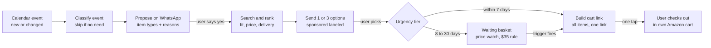

# Pattie — Product Requirements

Nov 20, 2026 · Emmalou Schmucker (product) · Living version: [Claude doc](https://claude.ai/artifact/5UatkYsXd49m5kqRdFWn5L)

## Summary

Pattie is a shopping agent that lives in WhatsApp and reads your Google Calendar. It spots events that need stuff (trips, parties, hackathons), proposes what you might need, finds it on Amazon, and gets your yes before anything is bought. It also handles food: when your day is packed, it asks ahead whether to order breakfast or dinner from DoorDash or Uber Eats.

**The problem.** Shopping tools wait for you to search. People forget the power bank before the flight, or end up hungry and ordering junk at 9pm after a full-day event. The calendar already knows what's coming, but nothing acts on it.

**The bet.** A calendar event is a strong signal of intent. An agent that turns events into a short, explained shortlist and asks one clear question saves time without taking control away. Pattie is named after Pattie Maes, and follows her principles: learn from the person, recommend for the situation, stay proactive, support judgment instead of replacing it, and keep sponsored placement separate from fit.

## Goals and success metrics

The hackathon goal is one reliable end-to-end demo: a calendar event becomes a WhatsApp proposal, then a one-tap Amazon cart, plus one proactive food nudge.

**Goals**

- Turn a calendar event into a relevant, explained product shortlist without the user typing a search.
- Keep the user in control: every purchase needs an explicit yes.
- Save money on non-urgent items through basket bundling and price watching.
- Show food nudges at the right moment, based on schedule gaps.

**Non-goals (for the hackathon)**

- Fully autonomous checkout without user confirmation.
- Getting around platform bot detection, or clicking or buying ads automatically.
- Supporting every event type; we cover four in the demo.
- Payments handled by Pattie. Checkout stays in the user's own Amazon or delivery account.

| Metric | Target for demo | Why it matters |
| --- | --- | --- |
| Events correctly classified as "needs products" | 8 of 10 test events | Proposals must feel relevant, not spammy |
| Proposal accept rate | ≥ 1 accepted item per relevant event | Shows the suggestions are useful |
| Time from event detected to cart link | < 60 seconds | Feels like magic on stage |
| Taps to buy | ≤ 3 (yes, open link, checkout) | Low friction while keeping control |
| Long-term basket savings | Shipping fee avoided + any price drop captured | Proves the bundling policy pays off |

## Users and user stories

The primary user is a busy professional or student with a full calendar who travels and goes to events often, and who already shops on Amazon and orders delivery.

| # | As a user, I want… | So that… | Priority |
| --- | --- | --- | --- |
| 1 | Pattie to notice my "Flight to NY" next week and suggest what I might need | I don't forget essentials | Must |
| 2 | To answer with a quick yes/no or pick an option in WhatsApp | Buying takes seconds | Must |
| 3 | One best pick when the choice is obvious, and three options when it isn't | I'm not overloaded, but stay in control | Must |
| 4 | A one-tap link that fills my Amazon cart | I check out in my own account | Must |
| 5 | To be asked the evening before a full-day event if I want breakfast delivered | I'm fed without planning it | Must |
| 6 | To be asked at 6pm if I want dinner when an event runs until 7 | Food arrives when I get home | Should |
| 7 | Non-urgent items to wait until the basket reaches $35 | I avoid shipping fees without Prime | Should |
| 8 | Pattie to watch prices on waiting items and buy at a good price | I get a better deal | Should |
| 9 | To see why each item was picked, and which results are sponsored | I can trust the recommendation | Must |
| 10 | To set budget, brands, dietary preferences and quiet hours | Pattie fits me and doesn't nag | Should |

## Core flows

Every flow ends with an explicit user yes and a checkout the user completes in their own account. Nothing is bought until the user says yes and checks out.

Urgent items go straight to a cart link. Items needed in 8 to 30 days wait in the basket until a price or shipping trigger fires.

### 1. Event detection

Pattie checks the calendar every 15 minutes and looks 30 days ahead. For each new or changed event, an LLM classifies it from the title, location, duration, attendees and description.

| Event type | Example | Typical needs | Food nudge? |
| --- | --- | --- | --- |
| Flight / long trip | "Flight to NY", 5+ days away | Travel adapter, packing cubes, toiletries, neck pillow | Airport meal if the flight is near a mealtime |
| Road trip | "Roadtrip Big Sur" | Car phone mount, snacks, cooler, charger | No |
| Short trip / vacation | "Weekend Tahoe" | Sunscreen, weather-specific gear | No |
| Social event | "Lisa's birthday" | Gift, card, wrapping, party supplies | No |
| Hackathon / full-day event | "Hackathon SF" | Power bank, snacks, energy drinks | Breakfast to the venue, dinner at home |
| Meetup / day event | "AI Meetup" | Usually nothing | Dinner if it ends late |

Events with no clear need are skipped silently. Pattie messages at most once per event, unless the user asks for more.

### 2. Proposal and consent

Pattie sends one WhatsApp message with up to five suggested item types and a reason for each. Example: "Flight to NY on Dec 3. Want me to look for a travel adapter, a neck pillow, and TSA-size toiletries?" The user replies with all, some, or none. No search starts before this yes.

### 3. Urgency tiers

The tier comes from the days left until the event, minus a buffer for delivery.

| Tier | Needed within | Delivery rule | Ordering behavior |
| --- | --- | --- | --- |
| ASAP | 0–2 days | Only items with guaranteed delivery before the event | Send a cart link right away |
| This week | 3–7 days | Standard delivery with an arrival date before the event | Send a cart link within the same day |
| Long-term | 8–30 days | Any delivery option | Add to the waiting basket (flow 5) |

### 4. One option or three

Pattie sends **one best option** with a yes/no when all of these are true:

- The budget for this item is known (set by the user, or learned from past purchases).
- The use case is clear from the event.
- The top product scores clearly higher than the next one on fit, rating, price and delivery date.

Otherwise it sends **three options**, each with one line on the trade-off (e.g. "cheapest", "best rated", "arrives soonest"). Each option shows price, rating, arrival date and why it fits. Sponsored results are labeled "Sponsored" and ranked by fit like everything else.

### 5. Long-term basket and price watch

Items in the long-term tier wait in a basket. Pattie checks prices once a day and orders when the first of these happens:

1. The basket total reaches $35 (free shipping without Prime).
2. An item drops at least 15% below the price it had when added.
3. The latest safe order date for any item arrives (event date minus delivery time minus a 2-day buffer).

Pattie then sends one combined cart link and a summary: "5 items, $41.20, free shipping, saved $6.80 vs. when you added them." Users with Prime skip the $35 rule and only use triggers 2 and 3.

### 6. Food delivery nudges

Pattie looks for gaps in the schedule where cooking or eating is unlikely.

| Trigger | When Pattie asks | Example message |
| --- | --- | --- |
| Full-day event starting before 9am | 8pm the evening before | "Hackathon starts at 8 tomorrow. Want breakfast delivered to the venue around 8:15? Your usual oat latte and bagel?" |
| Event ending at or after 7pm | 1 hour before it ends | "Your meetup ends at 7. Hungry when you're home? I can have Thai arrive around 7:45." |
| Back-to-back events over a mealtime | 1 hour before the meal gap | "No break between 11 and 3. Want lunch delivered to the office at 12:30?" |

Pattie uses stored preferences (cuisine, dietary restrictions, budget, favorite places) and the event location or home address. It times delivery to arrival, using the event start time or the travel time home.

## Purchase and platform access

Pattie never logs in or checks out for the user. It finds products, then hands off a pre-filled cart that the user confirms in their own account. This keeps us within platform rules and keeps the demo from being blocked live.

**Amazon**

- **Cart handoff link.** Pattie builds `https://www.amazon.com/gp/aws/cart/add.html?ASIN.1=<asin>&Quantity.1=1&ASIN.2=…`. One tap adds every item to the user's own logged-in cart. One link can hold the whole long-term basket.
- **Product data.** Amazon Product Advertising API (now moving to the Creators API). It needs an Amazon Associates account; check today whether we can get keys in time. Fallback for the demo: a curated product catalog for the four demo event types.
- **Price history.** Keepa API for current price, history and drop alerts. This powers the price watch.
- **Revenue.** Amazon Associates affiliate commission on cart links, disclosed to the user.

**Food delivery**

- DoorDash and Uber Eats have no public API for consumer orders (DoorDash Drive is for merchants). Pattie sends a deep link to the chosen restaurant with the suggested order written out, and the user checks out in the app.
- Instacart Developer Platform is a supported option for breakfast or grocery lists.

**Sponsored products**

- Sponsored items can appear when they are a good fit. They are always labeled "Sponsored" and ranked by the same fit score as everything else.
- Pattie shows the reason for each ranking, so the user can see that placement didn't decide the pick.

**What we will not build**

- Logging in as the user, or automated checkout.
- Anything that disguises the agent as a human to get past bot detection: faked browsing speed, spoofed locations, rotating residential IPs.
- Automated ad clicks, or a quota of ad purchases. That is click fraud, and it contradicts the anti-manipulation principle Pattie is built on.

## Technical architecture

One backend service runs a scheduler and a WhatsApp webhook. An LLM agent decides what to propose, and every outside system is reached through its official API or a handoff link.

| Component | Choice for the hackathon | Notes |
| --- | --- | --- |
| Messaging | Twilio WhatsApp sandbox | Fastest setup. Production needs Meta Business verification, and pre-approved templates for proactive messages sent outside the 24-hour window |
| Calendar | Google Calendar API, OAuth, polling every 15 min | Push notifications (watch channels) later |
| Agent | Claude (latest Sonnet) with tool calls | Tools: classify_event, suggest_items, search_products, rank_products, build_cart_link, add_to_basket, suggest_food |
| Product search | PA-API / Creators API, or a curated catalog fallback | Returns ASIN, title, price, rating, delivery estimate, sponsored flag |
| Price watch | Keepa API + daily cron job | Checks basket prices and fires the order triggers |
| Food | Deep links to DoorDash / Uber Eats, optional Instacart | Order text written by the agent |
| Storage | Postgres or SQLite | Users, preferences, events seen, proposals, basket, price history |
| Scheduler | Cron job / worker | Calendar polling, food-nudge timing, price checks |

**Data model (minimum)**

- `user`: phone, timezone, home address, has_prime, budgets per category, food preferences, quiet hours
- `event`: calendar id, type, start, end, location, processed_at
- `proposal`: event id, items, status (sent / accepted / declined)
- `basket_item`: ASIN, price when added, latest safe order date, status
- `price_point`: ASIN, price, checked_at

### Hackathon partner services

We plan to use four partners: Cognee, Airbyte, Persona and Amplitude + Statsig. Superlinked and Firedrill are good additions if time allows. The fit is judged from the partners' one-line descriptions on the [event page](https://luma.com/personalagenthack); confirm API access and credits with each sponsor at kickoff.

| Partner | What it offers | How Pattie uses it | Fit |
| --- | --- | --- | --- |
| Cognee | Open-source memory for agents | Long-term preference profile: budgets, brands, food likes, past accepts and declines. Feeds the one-vs-three rule | Core |
| Airbyte | Context layer for agents | Brings in Google Calendar events, plus optional Gmail order confirmations to learn past purchases | Core |
| Persona | Detects agents and verifies the people behind them | Verify the human behind Pattie at onboarding. Pitch angle: the answer to "Amazon blocks agents" is a verified, transparent agent, not a disguised one | Core |
| Amplitude + Statsig | Product analytics, feature flags, experiments | Track proposal accept rate and taps to buy; A/B test the one-vs-three threshold and nudge timing | Core |
| Superlinked | Task-specific inference for agents | Product ranking that combines fit, price, rating and delivery date | Optional |
| Firedrill | Simulation platform for agents | Simulate calendars and user replies to test proposals; test whether wording or ordering nudges Pattie's picks | Optional |
| SingleStore | Real-time data for agents | Price history and basket store for the price watch | Later |
| Arcee | Open-weight foundation models | Cheap model for event classification | Later |
| Guild AI | Build, evaluate and deploy AI systems | Agent evaluation and deployment | Later |

Several judges come from these partners (Amplitude, Cognee, Persona, Airbyte, Superlinked, Firedrill), so call out each integration in the demo.

## Hackathon demo

The demo is a 3-minute live run on one phone, using a test calendar seeded with four events.

1. **Setup (15 s).** Show the calendar: "Hackathon SF" tomorrow 8am–9pm, "Flight to NY" in 6 days, "Lisa's birthday" in 3 weeks, "AI Meetup" next week.
2. **Proactive message (30 s).** Pattie messages on WhatsApp: "Hackathon tomorrow, 13 hours. Want a power bank and some snacks? Arrives tonight." Reply "yes, power bank".
3. **One best option (30 s).** Budget is known, so Pattie sends one pick with its reason, price, rating and arrival time. Reply "yes", tap the cart link, and show the item in the Amazon cart.
4. **Three options (30 s).** For the flight, Pattie can't tell what kind of adapter is needed, so it sends three labeled options, one marked "Sponsored". Explain why it ranks where it does.
5. **Long-term basket (30 s).** The birthday gift goes into the basket: "$22 of $35. I'll wait and watch the price." Show the basket view and a simulated price drop that triggers the order.
6. **Food nudge (30 s).** Fast-forward to 8pm: "Hackathon starts at 8 tomorrow. Breakfast to the venue at 8:15?" Reply "yes", get the DoorDash link with the order written out.
7. **Close (15 s).** Pattie acted on the calendar, explained every pick, labeled sponsored items, and never bought anything without a yes.

**In scope:** flows 1–6 for the four seeded events, one test user, a curated catalog if the API keys don't arrive.
**Out of scope:** onboarding UI, multiple users, real payments, Uber Eats integration beyond a link.

**Owners**

- [ ] Product spec, demo script, seed calendar, pitch — Emmalou
- [ ] Backend, WhatsApp, Calendar, agent tools — Mauricio
- [ ] Product catalog / PA-API keys and Keepa key — owner to be decided
- [ ] Dry run of the full demo twice before judging — both

## Risks and open questions

| Risk | Impact | Mitigation |
| --- | --- | --- |
| No PA-API / Creators API keys in time | No live product data | Curated catalog of ~40 real ASINs for the demo events, same interface as the API |
| WhatsApp proactive-message rules | Messages blocked outside the 24h window | Twilio sandbox for the demo; template messages for production |
| Agent suggests irrelevant items | Feels like spam, users mute it | Max one message per event, skip unclear events, learn from declines |
| Wrong urgency tier or delivery date | Item arrives after the event | Use delivery estimates from the product data, plus a 2-day buffer |
| Food nudge at a bad moment | Annoying | Quiet hours, one nudge per meal, easy "stop food suggestions" |
| Calendar privacy concerns | Users won't connect it | Read-only scope, only titles/times/locations used, clear opt-in |

**Open questions**

- [ ] Which LLM tier for classification vs. ranking (cost vs. quality)?
- [ ] Should the one-option threshold be user-adjustable ("just buy it for me" vs. "always show me three")?
- [ ] Price-drop trigger: 15% the right number, or relative to Keepa's 90-day low?
- [ ] Do we show a web view for the long-term basket, or keep everything in WhatsApp?
- [ ] Confirm API access and credits with Cognee, Airbyte, Persona and Amplitude + Statsig at kickoff.
